# Upcoming posts

14 queued. Times are estimates in Asia/Kolkata.

## Grid

Newest at the top left, as the profile grid will look once everything is posted.

<table>
<tr><td></td><td></td><td>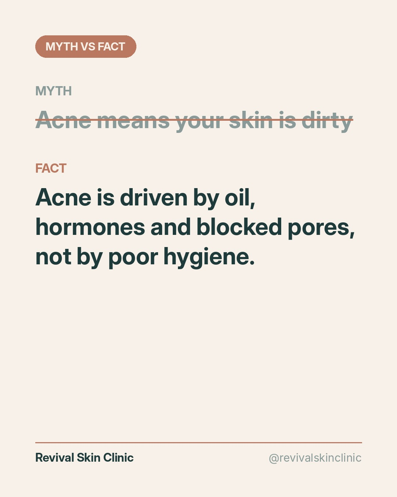</td></tr>
<tr><td>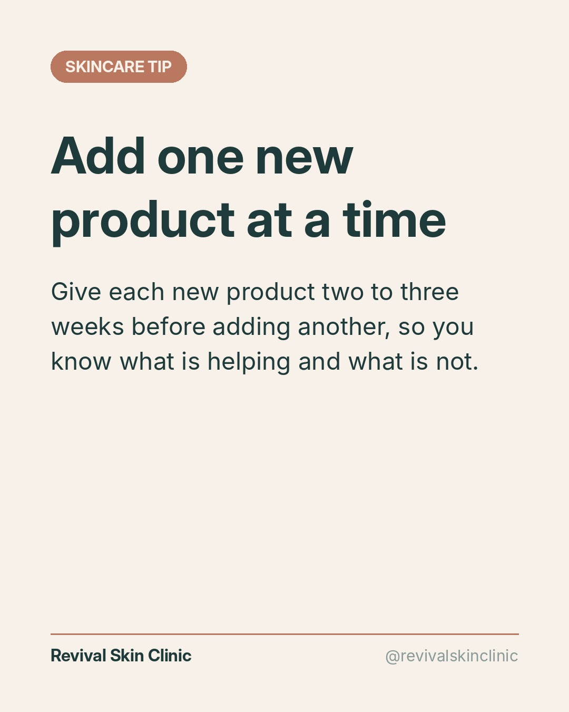</td><td>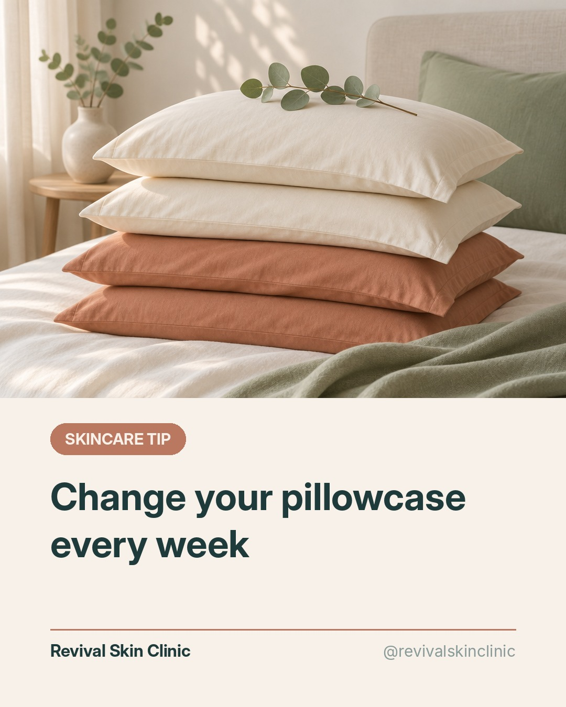</td><td>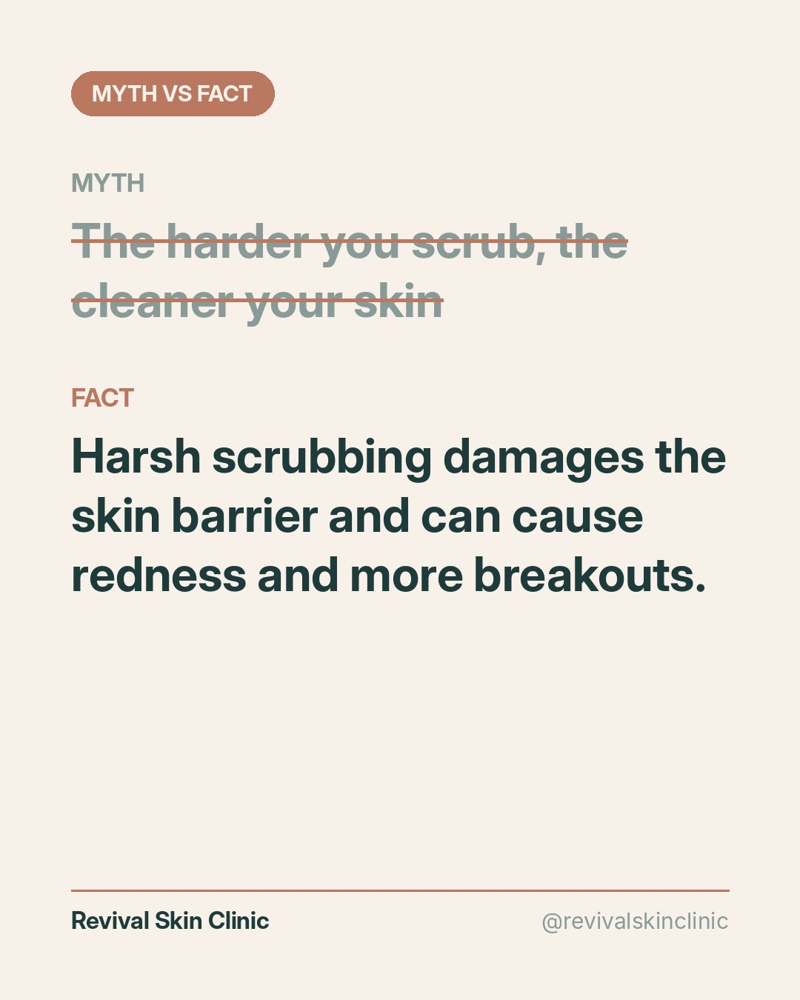</td></tr>
<tr><td>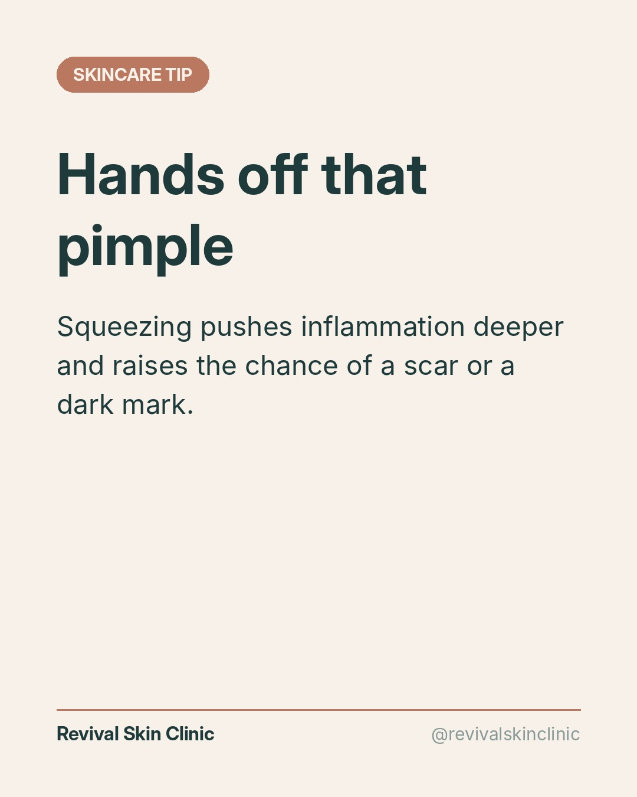</td><td>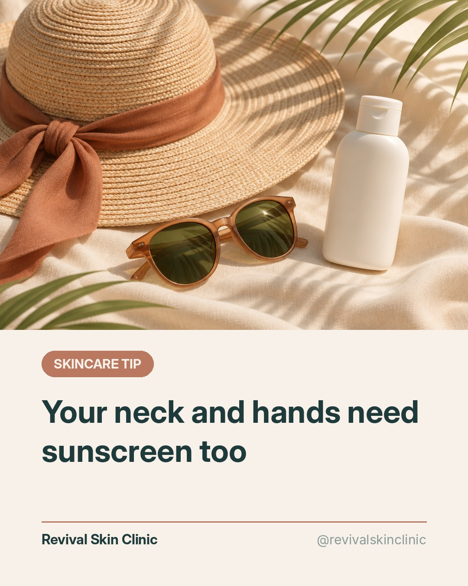</td><td>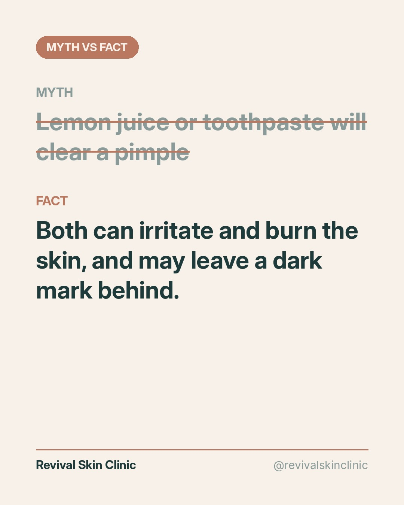</td></tr>
<tr><td>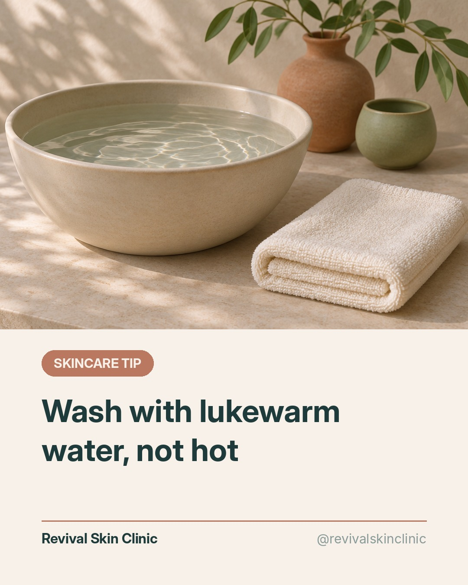</td><td>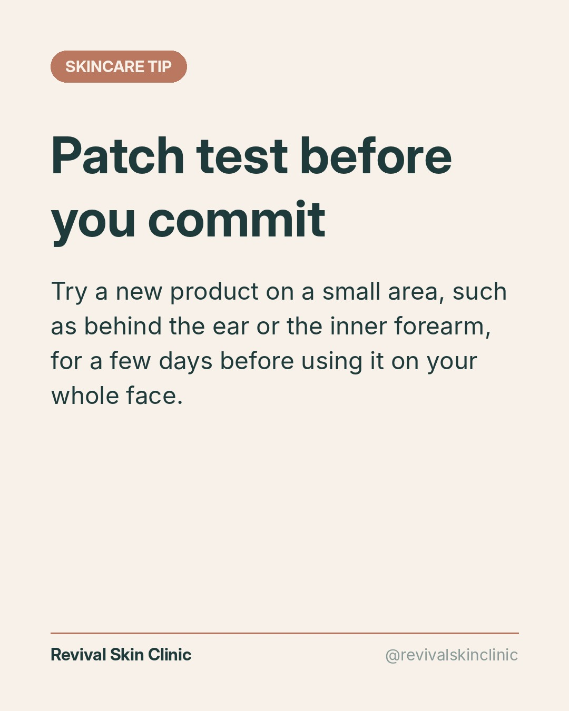</td><td>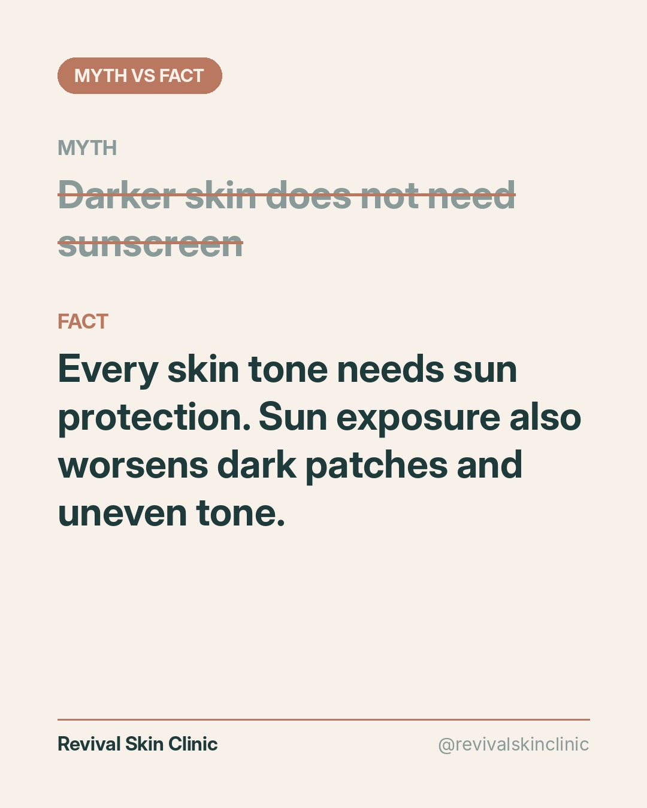</td></tr>
<tr><td>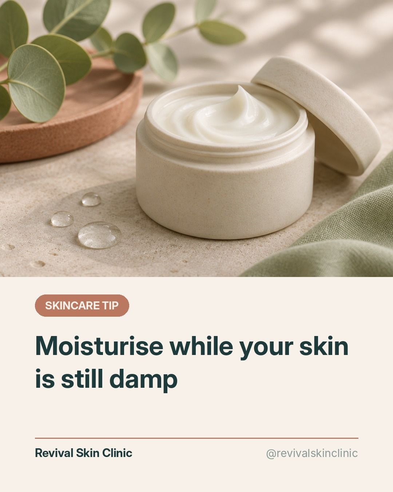</td><td>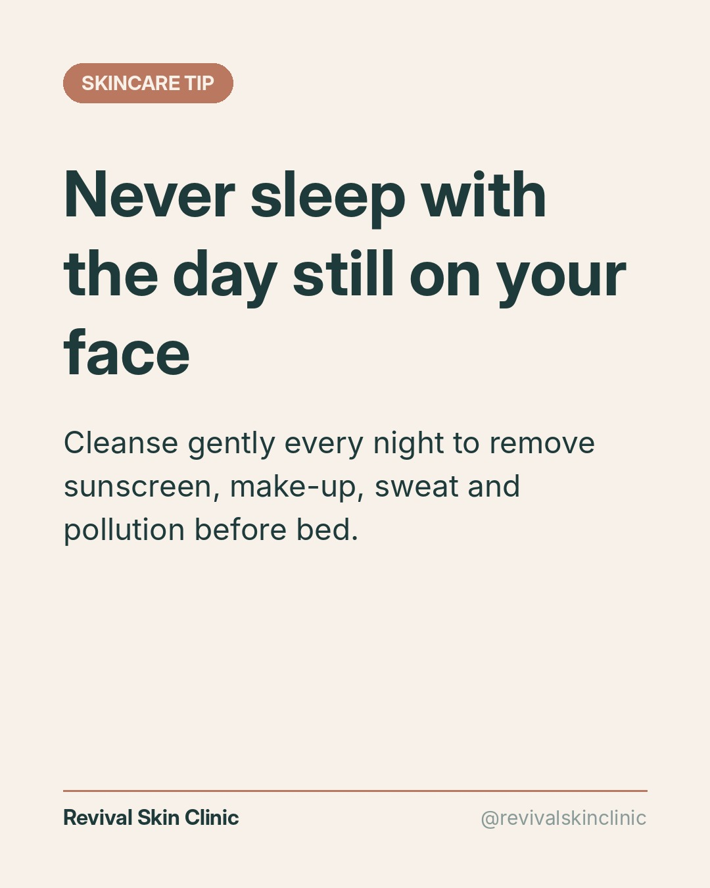</td></tr>
</table>

## Schedule

### Sat 28 Nov 2026, 19:00 — auto-20261127-03-wash-before-bed.jpg

_image_

> Through the day your skin collects sunscreen, make-up, sweat and city dust. A gentle cleanse before bed clears it away so your skin can rest overnight. One wash with a mild cleanser is enough; there is no need to scrub.
> 
> #cleansing #nightroutine #skincareroutine #skincaretips #healthyskin #dermatology

- Alt text: Skincare tip card reading: Never sleep with the day still on your face. Cleanse gently every night to remove sunscreen, make-up, sweat and pollution before bed.

### Sun 29 Nov 2026, 10:30 — auto-20261127-04-moisturise-damp-skin.jpg

_image_

> Moisturiser works best within a few minutes of washing, while the skin is still slightly damp. It helps hold that water in. Pat your face dry gently, then apply.
> 
> #moisturiser #hydration #dryskin #skincaretips #skincareroutine #healthyskin

- Alt text: Skincare tip card reading: Moisturise while your skin is still damp. Above the text is a still-life photograph of skincare items.

### Sun 29 Nov 2026, 19:00 — auto-20261127-05-darker-skin-sunscreen.jpg

_image_

> Melanin gives some natural protection, but not enough to prevent sun damage. In deeper skin tones, sun exposure is also a common reason dark marks and uneven tone linger. Daily sunscreen matters for everyone.
> 
> #sunscreen #melanin #pigmentation #skincaremyths #mythvsfact #indianskin #dermatology

- Alt text: Card reading: Myth: Darker skin does not need sunscreen. Fact: Every skin tone needs sun protection. Sun exposure also worsens dark patches and uneven tone.

### Mon 30 Nov 2026, 10:30 — auto-20261127-06-patch-test.jpg

_image_

> Even well-loved products do not suit everyone. Testing a small area first lets you spot redness, itching or burning before it affects your whole face. If a reaction appears, stop using the product; if it is severe or does not settle, see a dermatologist.
> 
> #patchtest #sensitiveskin #newskincare #skincaretips #healthyskin #dermatology

- Alt text: Skincare tip card reading: Patch test before you commit. Try a new product on a small area, such as behind the ear or the inner forearm, for a few days before using it on your whole face.

### Mon 30 Nov 2026, 19:00 — auto-20261127-07-lukewarm-water.jpg

_image_

> Hot water feels good but strips the skin's natural oils and can leave it dry and irritated. Lukewarm water cleans just as well and is far kinder, especially in winter.
> 
> #gentleskincare #dryskin #cleansing #winterskincare #skincaretips #healthyskin

- Alt text: Skincare tip card reading: Wash with lukewarm water, not hot. Above the text is a still-life photograph of skincare items.

### Tue 01 Dec 2026, 10:30 — auto-20261127-08-lemon-toothpaste.jpg

_image_

> Kitchen and bathroom remedies are not made for facial skin. Lemon juice is acidic and can make skin more sensitive to sunlight; toothpaste contains ingredients that irritate. If breakouts are frequent or leave marks, a dermatologist can assess what will suit your skin.
> 
> #acne #pimples #homeremedies #skincaremyths #mythvsfact #dermatology

- Alt text: Card reading: Myth: Lemon juice or toothpaste will clear a pimple. Fact: Both can irritate and burn the skin, and may leave a dark mark behind.

### Tue 01 Dec 2026, 19:00 — auto-20261127-09-neck-and-hands.jpg

_image_

> The neck, ears and backs of the hands get as much sun as the face, and are often forgotten. Take your sunscreen a little further each morning to cover them.
> 
> #sunscreen #sunprotection #spf #skincaretips #healthyskin #dermatology

- Alt text: Skincare tip card reading: Your neck and hands need sunscreen too. Above the text is a still-life photograph of skincare items.

### Wed 02 Dec 2026, 10:30 — auto-20261127-10-dont-pick.jpg

_image_

> It is tempting, but picking or squeezing usually makes a spot last longer and can leave a mark that takes months to fade. Keep the area clean and leave it alone. For painful, deep or recurring acne, a dermatologist should assess your skin.
> 
> #acne #pimples #acnescars #skincaretips #healthyskin #dermatology

- Alt text: Skincare tip card reading: Hands off that pimple. Squeezing pushes inflammation deeper and raises the chance of a scar or a dark mark.

### Wed 02 Dec 2026, 19:00 — auto-20261127-11-scrubbing.jpg

_image_

> Clean skin does not come from force. Rough scrubs and over-washing wear down the skin's protective barrier, leaving it red, tight and easily irritated. Be gentle: fingertips, a mild cleanser, and no more than twice a day.
> 
> #exfoliation #skinbarrier #gentleskincare #skincaremyths #mythvsfact #dermatology

- Alt text: Card reading: Myth: The harder you scrub, the cleaner your skin. Fact: Harsh scrubbing damages the skin barrier and can cause redness and more breakouts.

### Thu 03 Dec 2026, 10:30 — auto-20261127-12-fresh-pillowcase.jpg

_image_

> Your pillowcase collects oil, sweat and hair products night after night, and your face rests on it for hours. A fresh one each week is a small habit that helps keep skin comfortable. The same goes for face towels.
> 
> #skincarehabits #cleanskin #acnecare #skincaretips #healthyskin #dermatology

- Alt text: Skincare tip card reading: Change your pillowcase every week. Above the text is a still-life photograph of skincare items.

### Thu 03 Dec 2026, 19:00 — auto-20261127-13-one-product-at-a-time.jpg

_image_

> Starting several new products together makes it impossible to tell which one is working, or which one is causing a problem. Introduce them one by one and give your skin time to respond.
> 
> #skincareroutine #newskincare #sensitiveskin #skincaretips #healthyskin #dermatology

- Alt text: Skincare tip card reading: Add one new product at a time. Give each new product two to three weeks before adding another, so you know what is helping and what is not.

### Fri 04 Dec 2026, 10:30 — auto-20261127-14-acne-dirty-skin.jpg

_image_

> Acne is not a sign that someone is not washing enough, and washing more often will not cure it; over-washing can irritate skin further. Acne is a common medical condition, and a dermatologist can assess the right approach for each person.
> 
> #acne #acnemyths #skincaremyths #mythvsfact #acnecare #dermatology

- Alt text: Card reading: Myth: Acne means your skin is dirty. Fact: Acne is driven by oil, hormones and blocked pores, not by poor hygiene.

### Fri 04 Dec 2026, 19:00 — auto-20261128-01-chemical-peels.jpg

_image_

> A chemical peel uses a carefully chosen solution to remove the outer layers of skin, so that fresher skin can come through. Peels are used for concerns such as dullness, uneven tone, some kinds of pigmentation and acne.
> 
> A session is usually short. Some redness, dryness or flaking in the days after is common, and sun protection afterwards is essential. Peels vary in strength, and not every peel suits every skin, so a dermatologist should assess your skin first and choose the right one.
> 
> #chemicalpeel #skintreatment #pigmentation #acnecare #skinclinic #dermatology

- Alt text: Treatment explained card reading: Chemical peels: what they are and what to expect. Above the text is a still-life photograph of a small glass bowl, a brush and a dropper bottle.

### Sat 05 Dec 2026, 10:30 — auto-20261128-02-laser-hair-reduction.jpg

_image_

> Laser hair reduction uses light that is absorbed by the pigment in the hair. The heat it produces damages the hair follicle, so hair grows back finer and more slowly.
> 
> Because hair grows in cycles, treatment is done over several sessions spaced weeks apart, and occasional maintenance sessions may be needed. Results vary with hair colour, skin tone and hormones. A dermatologist should assess your skin and hair first to plan safe settings for you.
> 
> #laserhairreduction #laserhairremoval #unwantedhair #skinclinic #dermatology #skincare

- Alt text: Treatment explained card reading: Laser hair reduction: how it works. Above the text is a picture of a dermatologist in gloves and safety goggles holding a laser handpiece against a patient's lower leg, with the laser machine beside the bed.
