# Posts for review

Batch of 2026-11-27: 14 posts. Merge the pull request to queue them; nothing is published before that.

To drop a post, delete its two files in `queue/` on this branch. To change a caption, edit its `.txt` file.

## 1. Sunscreen every morning

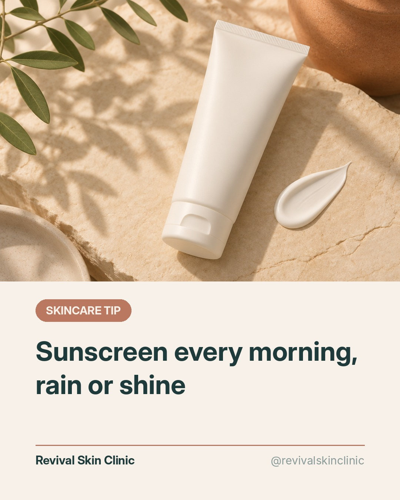

> UV rays reach your skin on cloudy days and through window glass too. A broad-spectrum sunscreen of SPF 30 or higher, applied every morning, is the single most useful habit for healthy skin. Use enough to cover the face, ears and neck.
> 
> #sunscreen #spf #sunprotection #skincaretips #healthyskin #dermatology

Files: `queue/auto-20261127-01-sunscreen-every-morning.jpg`, `queue/auto-20261127-01-sunscreen-every-morning.txt`

## 2. Oily skin moisturiser

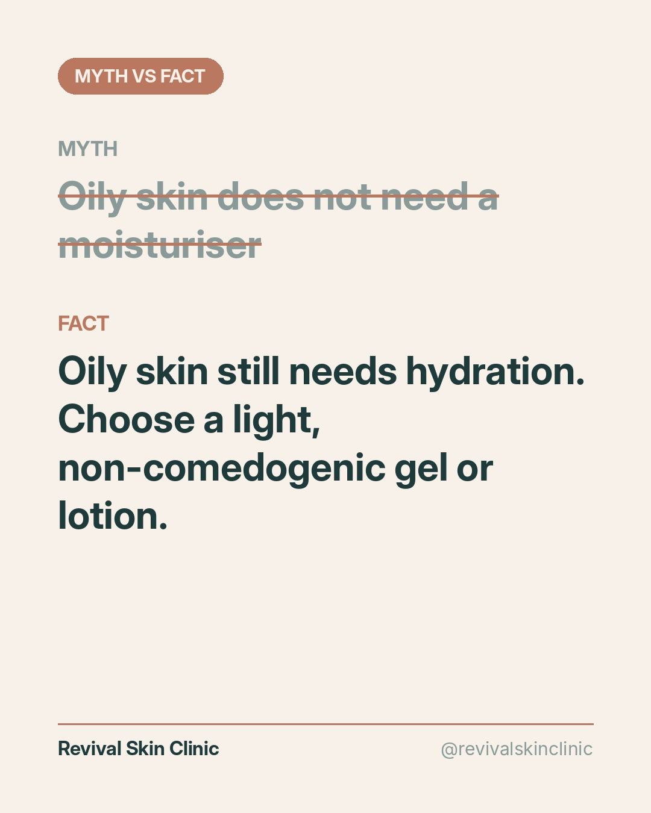

> Oil and water are not the same thing: skin can be oily and still short of moisture. Skipping moisturiser often leaves skin feeling tight and uncomfortable. A light, oil-free, non-comedogenic product is usually a good fit for oily skin.
> 
> #oilyskin #moisturiser #skincaremyths #mythvsfact #skincaretips #dermatology

Files: `queue/auto-20261127-02-oily-skin-moisturiser.jpg`, `queue/auto-20261127-02-oily-skin-moisturiser.txt`

## 3. Wash before bed

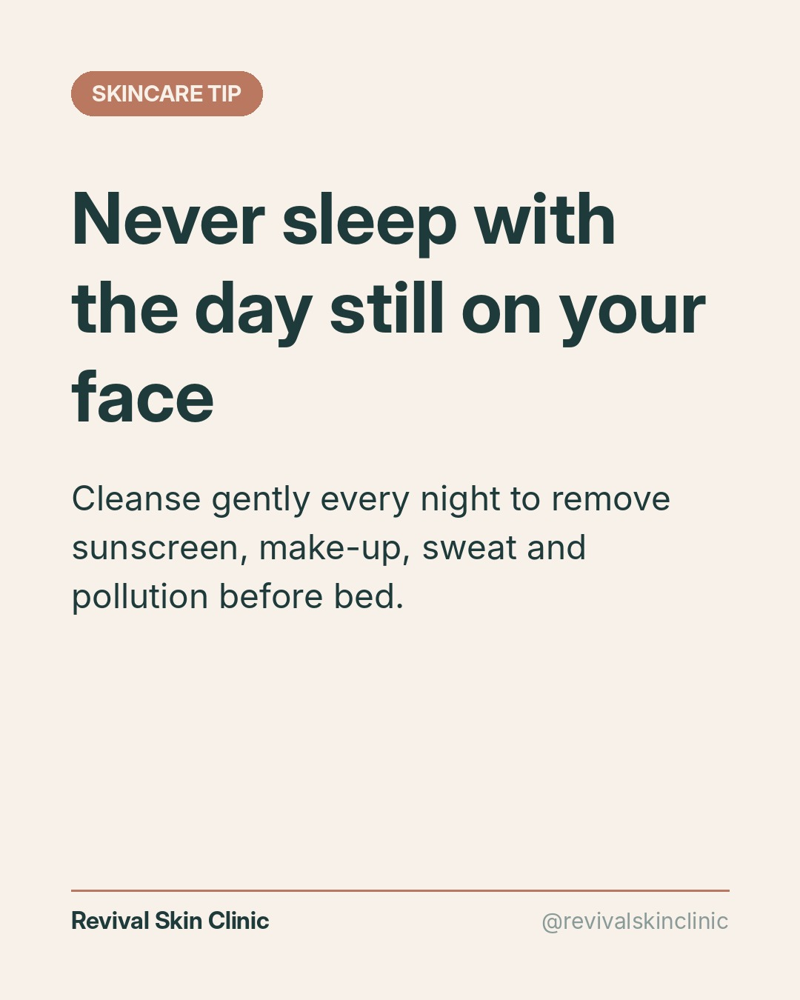

> Through the day your skin collects sunscreen, make-up, sweat and city dust. A gentle cleanse before bed clears it away so your skin can rest overnight. One wash with a mild cleanser is enough; there is no need to scrub.
> 
> #cleansing #nightroutine #skincareroutine #skincaretips #healthyskin #dermatology

Files: `queue/auto-20261127-03-wash-before-bed.jpg`, `queue/auto-20261127-03-wash-before-bed.txt`

## 4. Moisturise damp skin

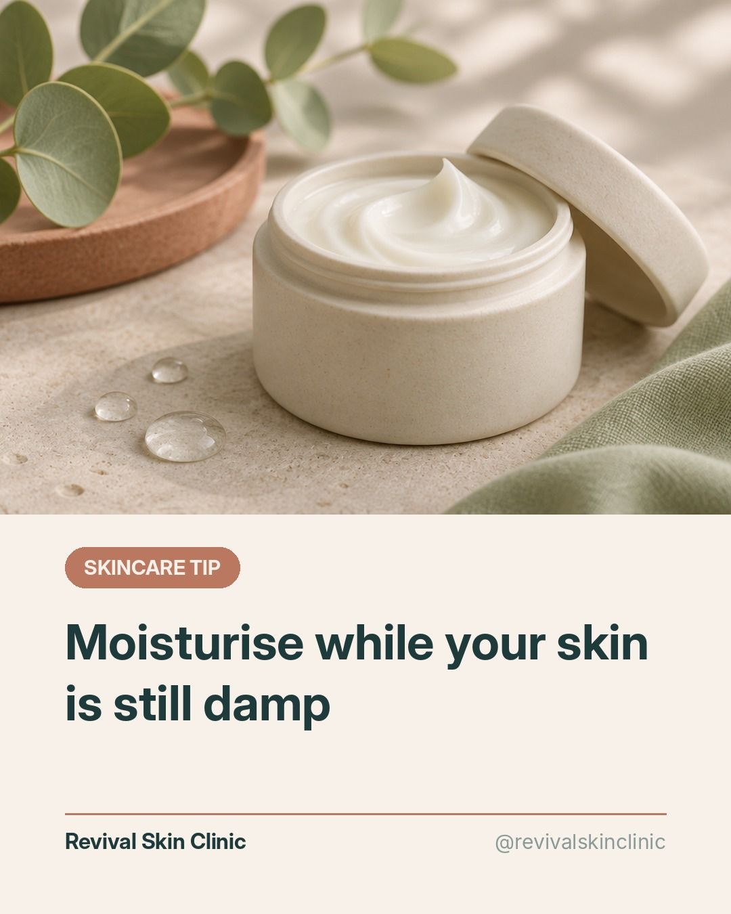

> Moisturiser works best within a few minutes of washing, while the skin is still slightly damp. It helps hold that water in. Pat your face dry gently, then apply.
> 
> #moisturiser #hydration #dryskin #skincaretips #skincareroutine #healthyskin

Files: `queue/auto-20261127-04-moisturise-damp-skin.jpg`, `queue/auto-20261127-04-moisturise-damp-skin.txt`

## 5. Darker skin sunscreen

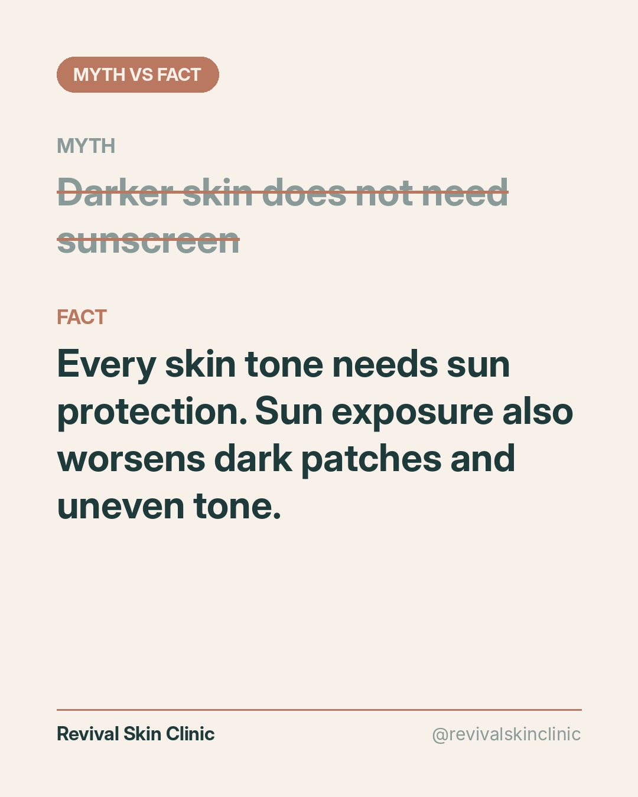

> Melanin gives some natural protection, but not enough to prevent sun damage. In deeper skin tones, sun exposure is also a common reason dark marks and uneven tone linger. Daily sunscreen matters for everyone.
> 
> #sunscreen #melanin #pigmentation #skincaremyths #mythvsfact #indianskin #dermatology

Files: `queue/auto-20261127-05-darker-skin-sunscreen.jpg`, `queue/auto-20261127-05-darker-skin-sunscreen.txt`

## 6. Patch test

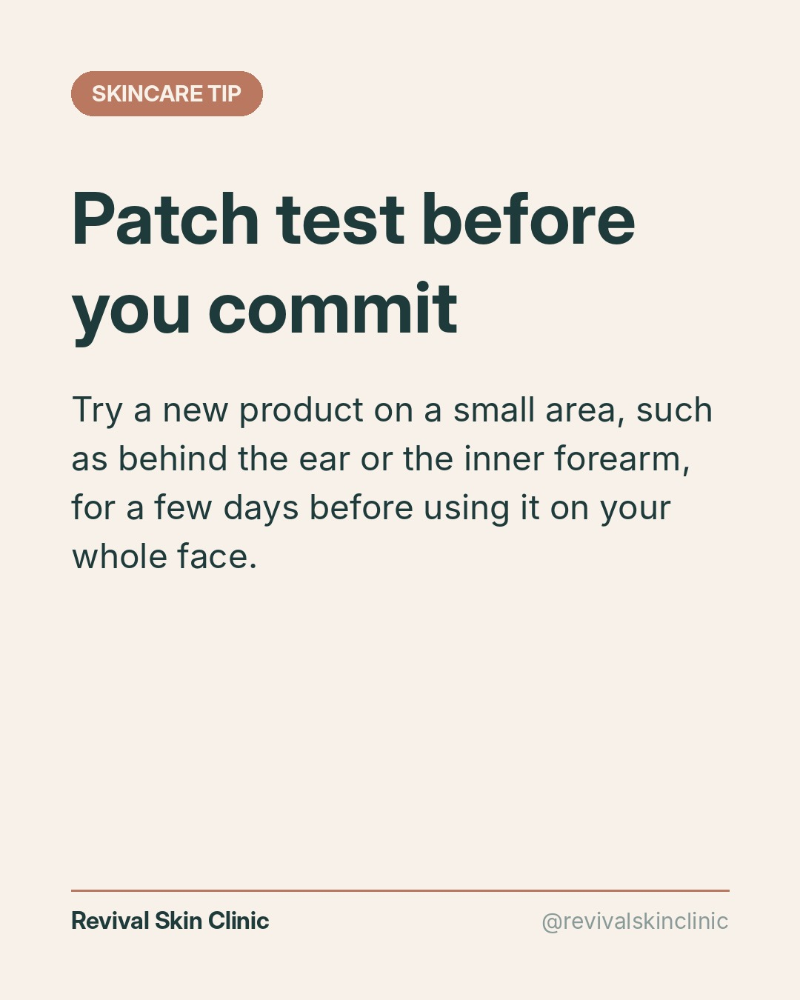

> Even well-loved products do not suit everyone. Testing a small area first lets you spot redness, itching or burning before it affects your whole face. If a reaction appears, stop using the product; if it is severe or does not settle, see a dermatologist.
> 
> #patchtest #sensitiveskin #newskincare #skincaretips #healthyskin #dermatology

Files: `queue/auto-20261127-06-patch-test.jpg`, `queue/auto-20261127-06-patch-test.txt`

## 7. Lukewarm water

> Hot water feels good but strips the skin's natural oils and can leave it dry and irritated. Lukewarm water cleans just as well and is far kinder, especially in winter.
> 
> #gentleskincare #dryskin #cleansing #winterskincare #skincaretips #healthyskin

Files: `queue/auto-20261127-07-lukewarm-water.jpg`, `queue/auto-20261127-07-lukewarm-water.txt`

## 8. Lemon toothpaste

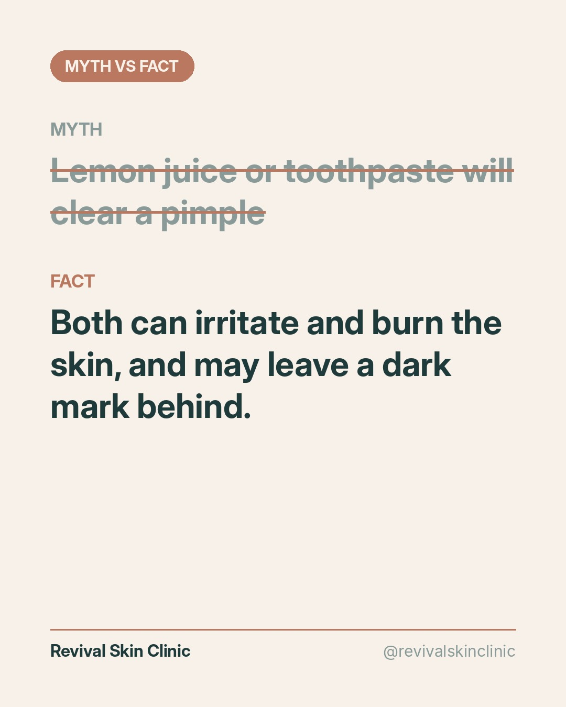

> Kitchen and bathroom remedies are not made for facial skin. Lemon juice is acidic and can make skin more sensitive to sunlight; toothpaste contains ingredients that irritate. If breakouts are frequent or leave marks, a dermatologist can assess what will suit your skin.
> 
> #acne #pimples #homeremedies #skincaremyths #mythvsfact #dermatology

Files: `queue/auto-20261127-08-lemon-toothpaste.jpg`, `queue/auto-20261127-08-lemon-toothpaste.txt`

## 9. Neck and hands

> The neck, ears and backs of the hands get as much sun as the face, and are often forgotten. Take your sunscreen a little further each morning to cover them.
> 
> #sunscreen #sunprotection #spf #skincaretips #healthyskin #dermatology

Files: `queue/auto-20261127-09-neck-and-hands.jpg`, `queue/auto-20261127-09-neck-and-hands.txt`

## 10. Dont pick

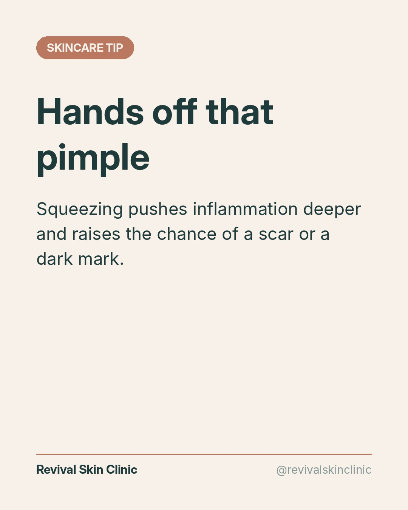

> It is tempting, but picking or squeezing usually makes a spot last longer and can leave a mark that takes months to fade. Keep the area clean and leave it alone. For painful, deep or recurring acne, a dermatologist should assess your skin.
> 
> #acne #pimples #acnescars #skincaretips #healthyskin #dermatology

Files: `queue/auto-20261127-10-dont-pick.jpg`, `queue/auto-20261127-10-dont-pick.txt`

## 11. Scrubbing

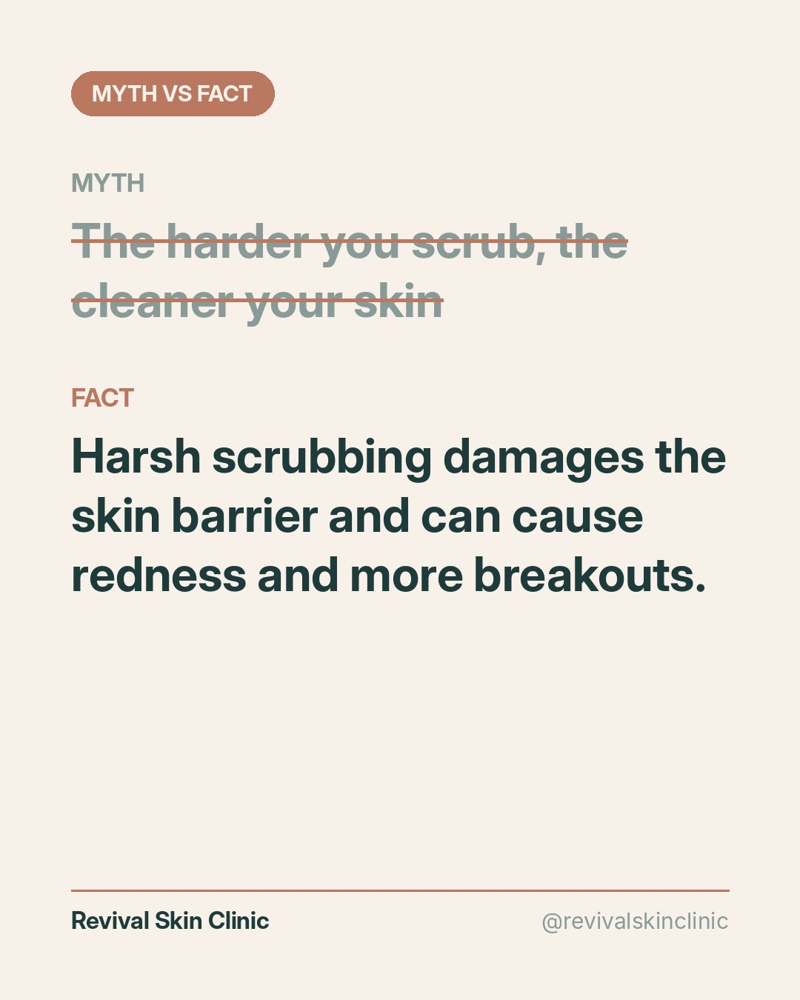

> Clean skin does not come from force. Rough scrubs and over-washing wear down the skin's protective barrier, leaving it red, tight and easily irritated. Be gentle: fingertips, a mild cleanser, and no more than twice a day.
> 
> #exfoliation #skinbarrier #gentleskincare #skincaremyths #mythvsfact #dermatology

Files: `queue/auto-20261127-11-scrubbing.jpg`, `queue/auto-20261127-11-scrubbing.txt`

## 12. Fresh pillowcase

> Your pillowcase collects oil, sweat and hair products night after night, and your face rests on it for hours. A fresh one each week is a small habit that helps keep skin comfortable. The same goes for face towels.
> 
> #skincarehabits #cleanskin #acnecare #skincaretips #healthyskin #dermatology

Files: `queue/auto-20261127-12-fresh-pillowcase.jpg`, `queue/auto-20261127-12-fresh-pillowcase.txt`

## 13. One product at a time

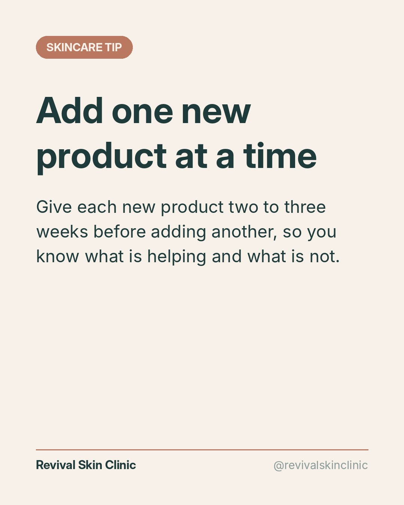

> Starting several new products together makes it impossible to tell which one is working, or which one is causing a problem. Introduce them one by one and give your skin time to respond.
> 
> #skincareroutine #newskincare #sensitiveskin #skincaretips #healthyskin #dermatology

Files: `queue/auto-20261127-13-one-product-at-a-time.jpg`, `queue/auto-20261127-13-one-product-at-a-time.txt`

## 14. Acne dirty skin

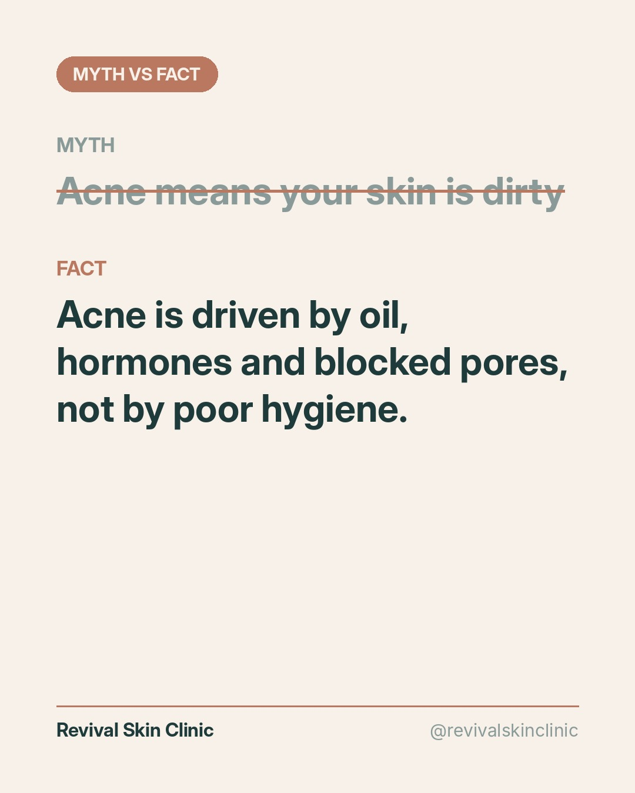

> Acne is not a sign that someone is not washing enough, and washing more often will not cure it; over-washing can irritate skin further. Acne is a common medical condition, and a dermatologist can assess the right approach for each person.
> 
> #acne #acnemyths #skincaremyths #mythvsfact #acnecare #dermatology

Files: `queue/auto-20261127-14-acne-dirty-skin.jpg`, `queue/auto-20261127-14-acne-dirty-skin.txt`
